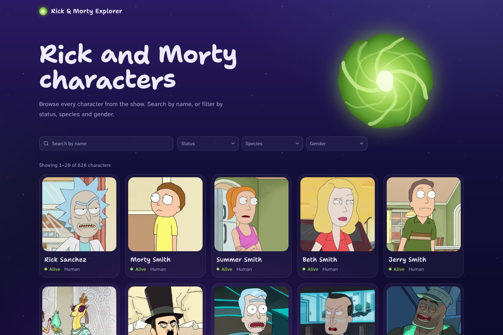
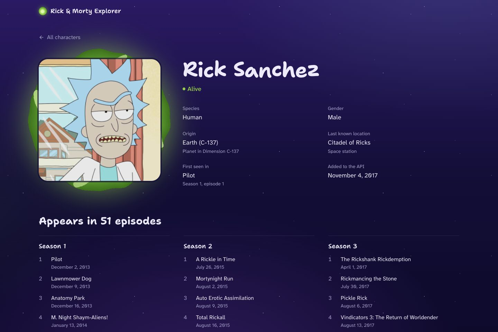

# Rick & Morty Explorer

Browse, search and filter every character from _Rick and Morty_, and open any of them to see their origin, last known location and every episode they appear in. Data comes from the public [Rick and Morty GraphQL API](https://rickandmortyapi.com/graphql).




## Features

- **Character list**: cards with portrait, name, status and species, with server-side pagination (20 per page, as the API returns them).
- **Search and filters**: search by name, and filter by status, species and gender. All of it goes through the API, and the state lives in the URL, so every view can be shared and the back button works.
- **Character page**: everything the API knows about a character, including all episodes grouped by season.
- **Smooth navigation**: the portrait morphs from its card into the character page and back. Pages slide in the direction you're going, results crossfade between pages and filters, and loading skeletons hand over to content.
- **Resilient states**: loading skeletons, empty results, unknown characters (404) and API failures with a retry button.
- Responsive down to small phones, keyboard accessible and respects reduced motion.

## Tech stack

| Area | Choice |
| --- | --- |
| Framework | [Next.js 16](https://nextjs.org) (App Router, Cache Components, Partial Prefetching), React 19.3 |
| Language | TypeScript 6 (strict) |
| GraphQL | [GraphQL Code Generator](https://the-guild.dev/graphql/codegen) (client preset) with a small typed `fetch` client |
| UI | [shadcn/ui](https://ui.shadcn.com) on [Base UI](https://base-ui.com), Tailwind CSS 4, Lucide icons |
| Fonts | Shantell Sans (headings), Atkinson Hyperlegible Next (text) |
| Tests | Vitest |
| Tooling | ESLint (`eslint-config-next`), Yarn 1 |

All dependencies are pinned to exact versions.

## Getting started

Requirements: **Node.js 24+** and **Yarn 1.22** (`npm i -g yarn`, or Corepack picks up the `packageManager` field).

```bash
yarn install
yarn dev
```

Open [http://localhost:3000](http://localhost:3000). No environment variables or API keys are needed.

For a production build:

```bash
yarn build
yarn start
```

Some behavior only exists in production builds, such as link prefetching. Use `yarn build && yarn start` to see navigation at its smoothest.

### Scripts

| Command | What it does |
| --- | --- |
| `yarn dev` | Start the development server |
| `yarn build` / `yarn start` | Build and serve the production app |
| `yarn lint` | Lint with ESLint |
| `yarn typecheck` | Generate Next route types and type-check with `tsc` |
| `yarn test` | Run unit tests with Vitest |
| `yarn codegen` | Regenerate GraphQL types from the live API schema |

## Project structure

```
src/
├── app/                        Routes (App Router)
│   ├── page.tsx                Character list: search, filters, results
│   ├── character/[id]/         Character page and its not-found state
│   ├── layout.tsx              Fonts, header, footer, space backdrop
│   ├── globals.css             Theme tokens and backdrop
│   └── view-transitions.css    View transition animations
├── components/
│   ├── characters/             Feature components (cards, filters, pagination, profile…)
│   ├── common/                 Shared pieces (error boundary, page transition, portal art)
│   ├── layout/                 Site header and footer
│   └── ui/                     shadcn/ui primitives (generated)
└── lib/
    ├── graphql/                Typed client, queries and generated types
    ├── characters.ts           Data access, cached on the server
    ├── search-params.ts        URL ⇄ list state (parse, validate, build links)
    ├── pagination.ts           Which page links to show
    ├── format.ts               Readable labels for API values
    └── *.test.ts               Unit tests next to the code they test
```

## How it works

### Data fetching

Queries are written in GraphQL and typed by **GraphQL Code Generator**, so variables and results are checked against the real schema. They run in **Server Components** through a ~50-line `fetch` client (`src/lib/graphql/client.ts`).

I chose this over Apollo Client because the app only reads public data. With server-first fetching, the HTML arrives already rendered, no GraphQL runtime ships to the browser, and Next's own caching does the work a client cache would. Apollo becomes the better fit once an app needs mutations, optimistic updates or live data.

- Requests are cached with `'use cache'` and `cacheLife('days')`, since the dataset rarely changes. `React.cache` shares one request between a page and its metadata.
- The generated types are committed, so `yarn install && yarn dev` works without running codegen. Run `yarn codegen` after changing a query.

### State in the URL

The list view is described entirely by its URL: `/?name=rick&status=alive&species=human&gender=male&page=2`. `src/lib/search-params.ts` parses and validates it, ignoring values the API doesn't support, and builds links back. Search input is debounced and replaces the URL as you type. Filter changes are history entries, and the dropdowns update optimistically (`useOptimistic`) while results load.

### View transitions

Navigation uses React 19.3's `<ViewTransition>`:

| Pattern | When |
| --- | --- |
| Shared element morph | A card portrait grows into the character page, and back |
| Directional slide | Forward into a character, back to the list; the header stays still |
| Crossfade | Results swap when the page or filters change |
| Suspense reveal | Skeletons slide out, content slides in |

The character page renders the portrait from the URL alone, so it can morph in the same frame as the click, before the rest of the data arrives. "All characters" returns to the exact list view you left (filters, page and scroll position). The browser's own Back button returns there instantly but without animation, because Next applies history traversals synchronously.

## Notes on the API

- **Rate limiting.** The API answers bursts of requests with `429` and `Retry-After: 10`, for both GraphQL and images. To stay under it, responses are cached, only the "Next" page link prefetches its data, and portraits load straight from the API's CDN instead of through the Next image optimizer, which would funnel every visitor through one server. If a limit is still hit, the page shows a retry button, and a throttled portrait falls back to a placeholder.
- **Species matching is partial**: filtering by "Human" also returns "Humanoid" characters. Pagination happens on the server, so the app can't narrow it down further.
- Missing values come back as `"unknown"` or empty strings, and are shown as readable labels ("Status unknown", "Unknown species").

## Possible improvements

- End-to-end tests (Playwright) for search, filters and navigation.
- Pages for locations and episodes, linked from the character page.
- Retry with backoff for rate-limited requests, and a shared remote cache (`'use cache: remote'`) when deployed on multiple instances.
